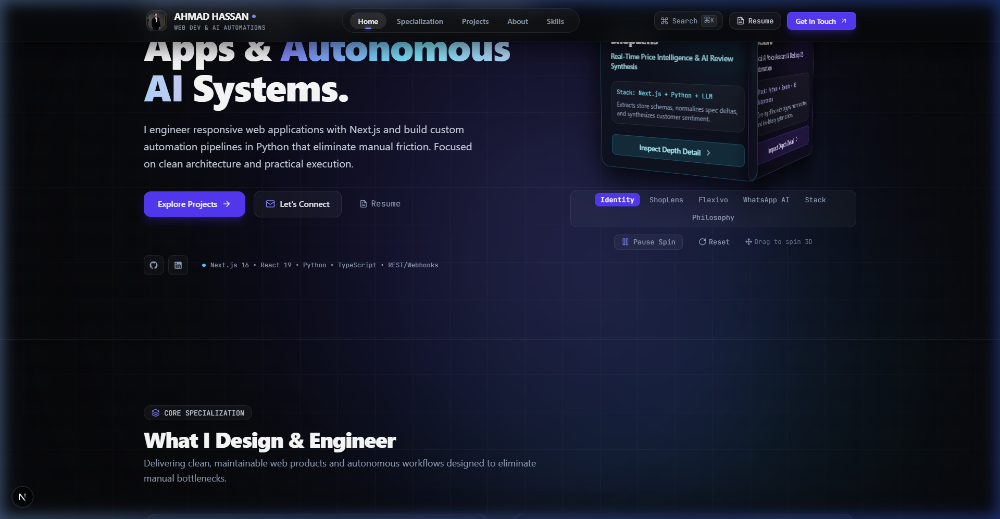

<div align="center">

# ⚡ Ahmad Hassan — Developer Platform
### *Computer Science Student & Aspiring AI Developer*

[](https://nextjs.org/)
[](https://react.dev/)
[](https://www.typescriptlang.org/)
[](https://tailwindcss.com/)
[](https://motion.dev/)
[](./LICENSE)

<br />

<p align="center">
  A modern, high-performance developer portfolio and digital command center designed to present technical coursework, system architecture, active prototypes, and AI-assisted workflows through an interactive, transparent interface.
</p>

[**Explore Live Demo**](#) • [**Report Bug**](https://github.com/Ahmad-Haassan/ahmad-portfolio/issues) • [**Request Feature**](https://github.com/Ahmad-Haassan/ahmad-portfolio/issues)

<br />



</div>

---

## 🌟 Key Architecture & Features

### 1. 🖥️ Interactive Developer Dashboard
- **Live Telemetry & Status**: Transparent view into active learning roadmaps, explored frameworks, and prototype lifecycles without arbitrary or inflated skill percentages.
- **Philosophy of Iteration**: Tracks the journey from theoretical computer science concepts (Data Structures, Algorithms, OS, Networks) to production-ready applications.

### 2. 🔬 Deep-Dive Project Case Studies
- **ShopLens**: Autonomous product research, price normalization, and review sentiment engine.
- **Flexivo**: AI-powered desktop assistant and workflow automation prototype built with speech synthesis and OS event routing.
- **WhatsApp Business Automation**: Webhook message dispatching, intent routing, and conversational AI response flows.
- **Interactive Modals**: System architecture diagrams, technology tags, and direct repository links.

### 3. ⚡ Command Palette (`Cmd + K` / `Ctrl + K`)
- Instant keyboard-driven navigation across sections, external profiles, resume inspection, and direct contact dispatchers.

### 4. 🤖 Built-In AI Portfolio Assistant
- Integrated conversational assistant trained on Ahmad's background, active projects, technical competencies, and contact preferences.

### 5. 🎨 Aesthetic & UX Engineering
- Cyberpunk-inspired dark aesthetic with subtle neon accents (`#A3FF12` Lime, `#00D9FF` Cyan, `#9B51E0` Purple).
- Smooth physics-based micro-interactions powered by `motion/react`.
- Fully responsive across ultra-wide monitors, laptops, tablets, and mobile devices.

---

## 🛠️ Technology Stack

| Layer | Technologies |
| :--- | :--- |
| **Framework** | [Next.js 16 (App Router)](https://nextjs.org/) |
| **Core Library** | [React 19](https://react.dev/) |
| **Language** | [TypeScript 5](https://www.typescriptlang.org/) |
| **Styling** | [Tailwind CSS v4](https://tailwindcss.com/) + Custom Glassmorphism Utilities |
| **Animations** | [Motion (Framer Motion v14)](https://motion.dev/) |
| **Icons** | [Lucide React](https://lucide.dev/) |
| **Version Control** | Git + GitHub CLI |

---

## 📂 Project Structure

```text
ahmad-portfolio/
├── .agents/                    # Autonomous developer rules & workflow automation
│   └── rules/
│       └── ship_workflow.md    # Automated conventional commit & devlog protocol
├── public/                     # Static media & showcase assets
│   └── showcase/
│       └── portfolio_showcase.png
├── src/
│   ├── app/                    # Next.js App Router pages and API routes
│   │   ├── api/chat/           # Portfolio Assistant AI endpoint
│   │   ├── layout.tsx          # Root layout & global metadata
│   │   └── page.tsx            # Main digital command center interface
│   ├── components/
│   │   ├── assistant/          # Conversational AI assistant components
│   │   ├── layout/             # Navbar, Footer, Background canvas effects
│   │   ├── projects/           # Case studies, project cards, and metrics
│   │   ├── sections/           # Hero, Dashboard, Skills, About, Journey
│   │   └── ui/                 # Command Palette, GlassCard, Modals, Buttons
│   └── lib/                    # Project datasets, telemetry state, and utils
├── LICENSE                     # MIT Open Source License
├── package.json
└── tsconfig.json
```

---

## 🚀 Getting Started

### Prerequisites
- Node.js `18.x` or higher
- npm, pnpm, or yarn

### Installation

1. **Clone the repository:**
   ```bash
   git clone https://github.com/Ahmad-Haassan/ahmad-portfolio.git
   cd ahmad-portfolio
   ```

2. **Install dependencies:**
   ```bash
   npm install
   ```

3. **Run local development server:**
   ```bash
   npm run dev
   ```

4. **Open in browser:**
   Navigate to https://ahmad-portfolio-olive-nine.vercel.app// to view the live build.

---

## 📬 Connect & Collaborate

- **GitHub**: [@Ahmad-Haassan](https://github.com/Ahmad-Haassan)
- **Email**: [ahmad5712126@gmail.com](mailto:ahmad5712126@gmail.com)
- **LinkedIn**: [Connect with Ahmad](https://linkedin.com)

---

## 📄 License

This project is open-source and available under the [MIT License](./LICENSE).
